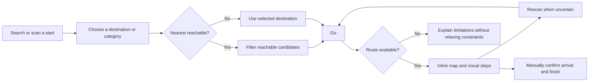
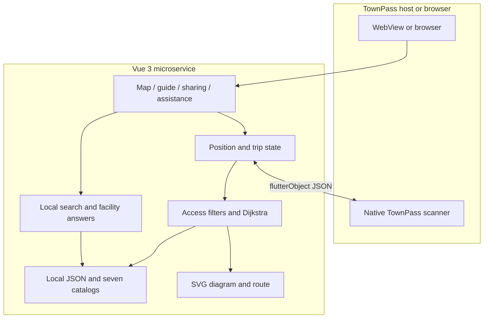
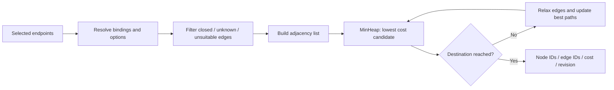
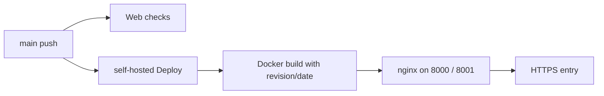

<div align="center">

# Taipei Main Station Wayfinding · 北車不迷路

**Find facilities, choose a reachable route, and follow readable visual directions inside TownPass.**

[繁體中文](./README.md) · **English**

[Try the service](https://codefest.yoyo899843.com/station-map) · [Changelog](./CHANGELOG.md) · [Contributing](./.github/CONTRIBUTING.md) · [Architecture](./.github/ARCHITECTURE.md)

</div>

We built **Taipei Main Station Wayfinding**, a **TownPass WebView microservice**, to help people find facilities, understand their next step and recover when unsure of their position. We connect search, reachable routes, QR recovery, visual guidance and fixed meeting places in one flow.

We run core search and routing against local data. You can try manually selected endpoints in a browser, then use native QR scanning through TownPass.

We have published **`v0.1.0-rc.1`**, with a partial diagram graph and the main interaction flow. We are still extending coverage and field validation; this prerelease is not an emergency navigation service or a certified wheelchair route.

## Contents

[Why](#why-this-project) · [Screenshot](#actual-screenshot) · [Features](#features-and-scope) · [Quick start](#quick-start) · [Walkthrough](#walkthrough-and-demo) · [Architecture](#architecture) · [Shortest paths](#how-we-compute-shortest-paths) · [Data](#data-and-coverage) · [Tests](#tests-and-quality) · [Deployment](#deployment-and-versioning) · [License](#provenance-and-licensing)

## Why this project

Station navigation involves more than finding a dot: a nearby restroom may be separated by a wall, a transfer may require a different floor, and a meeting place can be difficult to describe. We connect these tasks into one recoverable flow.

| User need | Approach |
| --- | --- |
| Find a facility that can actually be reached | Rank candidates by allowed graph path cost, not straight-line proximity |
| Understand the next action without switching screens | Keep map, direction icon, landmarks and previous/next controls together |
| Recover when uncertain about position | Keep the destination, confirm a new QR position, then recompute |
| Reduce reading and language barriers | Seven languages, local synonyms, Zhuyin/large-text preferences and expandable information |
| Meet friends or explain a problem to staff | Share a fixed place and show a staff-facing assistance card |

We plan to evaluate these choices through task completion, journey time and requests for assistance.

## Actual screenshot

<p align="center">
  
</p>

*We use this B4 view to show floor controls, facilities and map interaction. Captured 2026-11-08 at 08:47 Asia/Taipei, before the adaptive-height update. [Capture record](./assets/screenshots/README.md).*

### Actual iPhone simulator walkthrough

We show route selection, inline guidance and facility questions in these iPhone simulator captures from 2026-11-08 at 10:10 Asia/Taipei. Expand a section to inspect the original view.

<details>
<summary>Endpoints and step-free option: B4 north wheelchair waiting area → B1 M8 exit</summary>

[](./assets/screenshots/ios-endpoints-step-free.png)

</details>

<details>
<summary>Inline map and direction: step 10 of 12, previous/next, rescan and assistance</summary>

[](./assets/screenshots/ios-inline-route-steps.png)

</details>

<details>
<summary>Facility helper: answers, floor cards and reusable suggestions</summary>

[](./assets/screenshots/ios-local-facility-helper.png)

</details>

## Features and scope

- **Searchable endpoints:** collapsible floor groups, category/name/operator/exit-code/number matching, multilingual synonyms and bounded typo tolerance.
- **Nearest reachable facilities:** reuse the selected start and route restrictions; one primary Go action.
- **Step-free routing:** remove stairs, escalators and unknown accessibility edges before routing; do not silently relax constraints.
- **Inline guidance:** floor polylines, direction icons, landmarks, floor transitions and previous/next steps beside a map with adaptive height.
- **QR recovery:** a small confirmation dialog invokes existing single-scan TownPass capability. Cancellation preserves the trip.
- **Sharing and assistance:** share either fixed endpoint, show a staff card, rescan/cancel from the lower control group, and explicitly confirm arrival.
- **Reading preferences:** standard, child and elder modes; Zhuyin, larger text, themes and reduced-motion handling.
- **Seven local catalogs:** Traditional Chinese, English, Vietnamese, Indonesian, Thai, Korean and Japanese.
- **Local facility helper:** factual station-data answers, progress events, incremental text and facility cards; suggestions remain reusable.

We are prioritizing graph verification, translation review and Android/iPhone WebView validation. Full audio, offline startup and multiple-route comparison remain on our roadmap; the [Roadmap](#roadmap) describes the remaining validation scope.

## Quick start

We develop and verify the web app with **Node.js 20, npm and Git**. You can run search and routing without first setting up Flutter, model weights, an API key or a database.

```bash
git clone https://github.com/yoyo899843/CodeFest-2026-Taipei-Maze.git
cd CodeFest-2026-Taipei-Maze/app
npm ci
npm run serve -- --host 127.0.0.1 --port 8082
```

Open <http://127.0.0.1:8082/>. `/` redirects to `/station-map`; `/about` provides source/version/license information; `/meet` is the meeting-place entry. Historical test/orientation routes redirect to the station map.

### Browser versus TownPass

We support manual endpoints, search, routing, map interaction, steps, fixed-point sharing and local answers in a browser. Inside TownPass, we use `flutterObject` to call `qr_code_scan`; manual selection remains available without that bridge.

We confirm position at scan time and express directions in map bearings. Our current flow does not use GPS for indoor positioning or continuously track the phone's position or heading.

We keep the navigation UI and core logic on the web and reuse the host's native scanning capability. Our [TownPass integration notes](./integration/townpass/README.md) describe bridge and optional capability boundaries.

## Walkthrough and Demo



1. Select a start and destination; optionally swap or share either point. An existing start does not require another scan.
2. For nearby facilities, choose a category and enable Nearest reachable. Enable Step-free route when needed.
3. Select Go. Compare the map, direction and landmarks. Advancing a step does not update actual position.
4. Rescan if uncertain; manually confirm arrival and finish without fabricating a new QR position.

| Scenario | Start → destination | Conditions / expected result |
| --- | --- | --- |
| Same-floor restroom | `b1-e4` → `b1-wc-m5` | Ordinary route succeeds |
| Short floor transfer | `b3-info` → `b4-e2` | Ordinary route succeeds |
| Elevator transfer | `b3-e2` → `b4-e2` | Step-free model route succeeds |
| B4 wheelchair waiting area to M8 | `b4-wait-n` → `b1-exit-m8` | Enable step-free; 12 steps; ends at the **B1 exit point, not a verified street-level exit** |
| Conservative refusal | `b1-e4` → `b1-wc-m5` | Step-free returns no route; insufficient data does not prove actual inaccessibility |

[Load B4 → M8 endpoints](https://codefest.yoyo899843.com/station-map?start=b4-wait-n&destination=b1-exit-m8), then explicitly enable step-free routing. `/station-map?demo=1` provides fixed scenarios, simulated movement and equipment outages. Keep simulation labels visible; these are not field-position evidence.

## Architecture



- **UI:** We combine Vue 3, Vue Router, JavaScript ES modules, HTML/CSS and SVG.
- **Routing:** We expand compact JSON into a directed graph, apply hard access filters, then run Dijkstra with the same restrictions for nearest facilities.
- **Search:** We use Unicode normalization, a local synonym/intent dictionary and Optimal String Alignment.
- **State:** We separate QR, manual, link and Demo sources and tie manual arrival to the current trip.
- **Assistant:** We use internal `thinking`, `delta` and `done` events to keep local queries separate from progressive UI rendering.
- **Delivery:** We build static assets through Docker, serve them with nginx and run checks/deployment through GitHub Actions.

### Repository layout

```text
.
├── app/
│   ├── src/
│   │   ├── components/     # reusable and station UI
│   │   ├── views/          # route-level composition and station diagrams
│   │   ├── station/        # diagram graph, routing, position and place sharing
│   │   ├── navigation/     # core routing/bridge primitives and test fixture
│   │   ├── search/         # local multilingual search
│   │   ├── chat/           # local answers, stream events and native adapter
│   │   ├── display/        # reading preferences and Zhuyin
│   │   ├── i18n/           # seven catalogs and place names
│   │   ├── meeting/        # fixed meeting-place data and logic
│   │   └── staff/          # assistance data
│   ├── tests/              # Node and Vue renderer regression tests
│   ├── scripts/            # asset validation and graph generation
│   └── Dockerfile
├── assets/screenshots/     # actual screenshot and provenance
├── data/                   # attributed research snapshots and source index
├── tools/                  # data, QR, bundle and model maintenance tools
├── integration/townpass/   # historical patches, diagnostics and notices
├── scripts/                # opt-in historical host tooling
├── .github/                # CI and contributor/architecture/security guides
├── compose.yml
├── README.md               # default Traditional Chinese documentation
└── README.en.md            # English edition
```

We separate navigation, search, position state and presentation by feature so that we can test and maintain them independently. See [Architecture](./.github/ARCHITECTURE.md) for contracts and boundaries.

### How we compute shortest paths

We model navigation as a weighted directed graph `G = (V, E)`. Nodes represent facilities, corridor turns and connector endpoints. We resolve a selected place ID through a binding before routing.

Our current expanded graph has **359 nodes and 3,162 directed edges**, comprising 1,562 corridor pairs and 38 vertical directed edges. Only 125 nodes bind selectable places; the others mainly support entrances and turns. We do not expose every helper node as a facility or QR anchor.

#### 1. Building a walkable diagram graph

We explicitly run `npm run build:walking` after changing diagram sources to invoke our [graph builder](./app/scripts/build-walking-network.mjs). The regular `npm run build` only builds the web app and does not regenerate the graph:

1. Load walkable floor polygons and exclude context regions outside the modeled station space.
2. Add bound facilities and helper nodes inset from corners.
3. Validate ordinary same-floor segments with `segmentInWalkAreas` and diagram clearance checks.
4. Retain up to eight nearest visible neighbors per node and deduplicate pairs. Other nodes can link back, so final degree can exceed eight.
5. Add separate inferred entrance edges for some off-corridor icons, with unknown accessibility; step-free requests reject them.
6. Add vertical edges only from recorded connector endpoints, then validate IDs, positive costs, floors, provenance and access fields.

We store each two-way corridor once and expand both directions at runtime. This is a sparse diagram graph: our result is the **minimum-cost path in that graph**, not necessarily the geometric optimum in continuous space or the actual station's complete route network.

#### 2. Defining cost

```text
corridor cost = round(hypot(x₂ − x₁, y₂ − y₁), 1 decimal place)
elevator floor-change cost = 120
stairs / escalator floor-change cost = 90
route cost = sum of allowed edge costs
```

We use fixed floor-change costs to express switching overhead. We have not calibrated them against walking, elevator waits or congestion, so we report diagram cost rather than fastest journey minutes.

For step-free routing, we remove unsuitable edges instead of assigning stairs a large penalty. A costly alternative must not make stairs admissible.

#### 3. Filtering before Dijkstra

Our [walking router](./app/src/station/walking.mjs) constructs an allowed subgraph for each request:

| Condition | Our action |
| --- | --- |
| Not open, or explicitly unverified | Exclude |
| Ticket required but not allowed | Exclude; fare gates/paid areas are not fully modeled yet |
| User-excluded edge type | Exclude |
| Unavailable connector ID | Exclude |
| Step-free request with stairs/escalator | Exclude |
| Step-free request without both `stepFree === true` and `wheelchairPassable === true` | Exclude |

We admit diagram-checked edges without describing them as field-verified. Ordinary and step-free requests therefore share the same data but use different permitted subgraphs.



#### 4. Dijkstra implementation choices

Our [core](./app/src/navigation/dijkstra.mjs) uses an adjacency list, `MinHeap`, `best` candidates and a `settled` set:

- We initialize the start with zero cost and pop the lowest cumulative-cost candidate.
- We relax neighbors using `candidate = current.cost + edge.cost` and push improvements.
- We use lazy updates rather than decrease-key: stale heap entries are discarded when popped.
- We treat costs within `1e-9` as approximately equal and use edge-ID path keys for stable tie decisions.
- We return when the destination is popped, `NoRoute` when the queue empties, and `InvalidGraph` for non-finite accumulated cost.

With `V` nodes and `E` directed edges, basic lazy-heap work is approximately `O((V + E) log E)`. We also copy candidate node/edge arrays and compare path keys, adding route-length-dependent time and memory overhead beyond the textbook distance-only version.

We favor traceable behavior at the current scale. For larger venues, we plan to evaluate predecessor-based reconstruction, adjacency reuse and device latency/memory measurements. We have not implemented A*: it would need a heuristic compatible with our cost model, and it would not resolve missing field data.

### How we find the nearest reachable facility

We filter enabled candidates by category and, for step-free requests, require `accessibleFacility === true`. We then route to each candidate with identical restrictions, discard failures and sort successes by cost, using point IDs to break ties.

```text
candidate facilities → same start and access options → route each candidate
                     → keep successful routes → sort by graph cost → top k
```

With `K` candidates, we currently perform roughly `K` point-to-point searches plus sorting. We do not claim that this is already a single Dijkstra traversal. At larger scale, we could reuse one single-source result for multiple destinations; reverse-graph multi-source search is another option for repeated nearest-category queries.

We distinguish reaching a facility from the facility itself meeting a requirement. A familiar name does not establish accessible entrances or corridors.

### Turning routes into visual instructions

Our [presentation helpers](./app/src/station/walk-route.mjs) produce per-floor polylines and `walk`, `floor` and `arrive` steps:

- We split walking sections at named places or turns of at least **35°**, ignoring vectors shorter than **two diagram units** to reduce coordinate noise.
- We end highlighted geometry at the actual turn while naming the next recognizable checkpoint. Internal `corner-*` and `*-entrance` IDs are not public facilities or QR points.
- We close the current walking section before a vertical edge and show the connector, target floor and up/down direction separately.
- We derive map bearings with `atan2(Δx, -Δy)`: 0° points up the diagram and angles increase clockwise. These are not measured phone headings.
- We size the map using the visible viewport and measured surrounding controls, favor the map as the main visual area and allow normal page scrolling when crowded.

Several consecutive steps can refer toward the same named facility while highlighting distinct corridor turns. We derive steps from geometry rather than playing a fixed instruction script.

### Multilingual search and typo tolerance

In our [search module](./app/src/search/search.mjs), we normalize NFKC, case and spacing, then combine floor parsing, dictionary synonyms, intents and name/exit-code matching. Only eligible unresolved queries enter fuzzy matching.

We use **Optimal String Alignment** over Unicode code points for insertion, deletion, substitution and adjacent transposition costs. A comparison of lengths `m` and `n` takes `O(mn)` work; we retain only recent rows rather than a full matrix.

| Alias length | Maximum edit distance |
| --- | ---: |
| Under four code points | No fuzzy correction |
| Four to seven | 1 |
| Eight or more | 2 |

We also cap the distance ratio at 0.3, exclude code/number-like aliases from this correction and share a default budget of **100,000 DP cell operations** across a query. Exhaustion returns `incomplete`; fuzzy matches are suggestions, and unresolved modifiers or conflicts request clarification.

Search candidates start with `reachability: "unknown"`; the routing engine establishes graph reachability separately. Our search core requests further handling for nearest intent, and the UI delegates that task to the nearest-facility router rather than treating text matching as path ranking.

### Keeping position and trip state consistent

We separate QR, manual, link and Demo position sources. A manual arrival receipt is tied to endpoints, position token, step-free options, excluded edge types and unavailable connectors; relevant changes invalidate it.

The legacy TownPass scanner has no request ID, so we share a channel for same-name requests: one pending scan, a draining state after timeout, and quarantine of late replies before retry. We also handle duplicate iOS events and remount/HMR ownership so a reply is not reused accidentally.

Our helper uses local `thinking`, `delta` and `done` events for processing status, text and cards, with stop/collapse cancellation. These UI events are separate from position updates and native model token streaming.

<details>
<summary>Reproduce the B4 wheelchair waiting area → M8 step-free query locally</summary>

Run from `app/`:

```bash
node --input-type=module <<'JS'
import { readFileSync } from "node:fs";
import {
  walkingRouter,
  planWalk,
  routeSteps,
} from "./src/station/walk-route.mjs";

const graph = JSON.parse(
  readFileSync("src/station/walking-network.json", "utf8")
);
const result = planWalk(walkingRouter(graph), {
  startId: "b4-wait-n",
  destinationId: "b1-exit-m8",
  stepFree: true,
});
console.log({
  status: result.type,
  cost: result.route?.cost,
  steps: routeSteps(result.route).length,
});
JS
```

With the current graph we get `success`, cost `1316.7` and `12` steps. We route only to the B1 M8 diagram point; the street-level segment still needs separate verification.

</details>

## Data and coverage

| Floor | Displayed places | Bound to walking graph |
| --- | ---: | ---: |
| 1F | 46 | 0 |
| B1 | 44 | 41 |
| B2 | 86 | 32 |
| B3 | 35 | 35 |
| B4 | 17 | 17 |
| **Total** | **228** | **125** |

We currently maintain graph version `2026.11.08-diagram` and 19 recorded floor connections. We use **relative diagram costs**, which we have not calibrated to meters or journey time. 1F, B2 railway platforms and some B1 points remain unbound; bindings also need field checks for actual connectivity.

We use the following sources to build and review the station data:

- **Taipei Metro station plans, facilities and cross-sections:** relative floor, corridor and equipment geometry.
- **TRA/THSR official plans:** railway platform order and equipment checks; preserve red/purple markers without fabricating track crossings.
- **Taipei Open Data:** 10 official CSV research snapshots and station subsets; a 48-source index does not mean 48 live integrations.
- **Owner-supplied 1F plan photograph:** diagram reference only; the original photo is not bundled and derivative rights review remains pending.

[Research data](./data/README.md) · [Attribution](./data/ATTRIBUTION.md) · [Source catalog](./data/SOURCE_CATALOG.md) · [Third-party notices](./THIRD_PARTY_NOTICES.md)

```bash
cd app
npm run build:walking
npm run validate:assets
```

We expand coverage by verifying corridors, entrances, facilities and connector endpoints. Step-free routes also need verification of the full exit-to-street segment.

## Tests and quality

```bash
cd app
npm test
npm run lint
npm run validate:assets
npm run build
cd ..
python3 -m unittest discover -s tools -p 'test_*.py'
git diff --check
```

We run web and Python checks through Web checks, covering routes/restrictions, search, bridge state, location links, sharing, arrival and Vue renderer output. We build production files into `app/dist/` and separately validate browser visuals, native camera, assistive technology, lifecycle and field behavior.

We audited dependencies on 2026-11-08: runtime-only checks reported no findings, while the development toolchain retained 18 (8 high, 10 moderate). We plan to modernize the Vue CLI toolchain. We bind development to loopback and serve production through nginx; see [Security](./.github/SECURITY.md) for the audit scope.

## Deployment and versioning

```bash
export CODEFEST_COMMIT="$(git rev-parse HEAD)"
export CODEFEST_BUILD_DATE="$(date -u +%Y-%m-%d)"
docker compose up -d --build
```

We expose ports `8000` and `8001` through Compose and provide HTTPS using Cloudflare Tunnel or an existing reverse proxy. Our main-push Deploy workflow pulls, builds, starts services and checks both ports. Web checks run independently, so we also complete local validation before pushing.

We pass the revision and build date into production containers so that the information page can link to matching source. Local Git checkouts can detect their SHA automatically; a container without a passed commit or Git metadata displays an unknown revision.



We also retain a manually triggered Android host integration check. Native models, voice and device behavior have their own validation process.

## Roadmap

We currently rely on a diagram model. QR labels are not installed on site; native model/voice, full audio, translation review and fresh-install offline behavior still need validation. A Gemma UI label alone is not inference evidence. We are moving forward in this order:

1. Field-check a continuous area, including equipment, entrances and QR placement.
2. Validate Android/iPhone WebView, lifecycle, assistive technology and reading modes.
3. Review all translations and separately verify audio/offline behavior.
4. Establish equipment-closure, construction and label-inspection responsibilities.
5. Evaluate cognitive multi-route comparison, on-device models and other public venues.

## Contributing and security

We welcome issues and contributions. See [Contributing](./.github/CONTRIBUTING.md) and [Security](./.github/SECURITY.md). Reports should include revision, device, locale/mode, point IDs, route options and reproduction steps. Do not publish personal data, tokens or private scan contents. Use English Conventional Commits and the open-source PR template.

## Provenance and licensing

We publish our original code under **AGPL-3.0-or-later**: [LICENSE](./LICENSE), [AGPL_NOTICE](./AGPL_NOTICE.md). We preserve the separate terms of TownPass and third-party code, data, maps and models; our AGPL license does not cover all third-party content.

We record research attribution in [data/ATTRIBUTION.md](./data/ATTRIBUTION.md) and continue reviewing redistribution rights for imported prototype code and map derivatives. Sources, terms and review status are listed in [THIRD_PARTY_NOTICES.md](./THIRD_PARTY_NOTICES.md).

We thank TownPass, Taipei Metro, TRA, THSR and Taipei Open Data for references and foundations. We develop this project independently; these organizations have not endorsed it as an official service.
