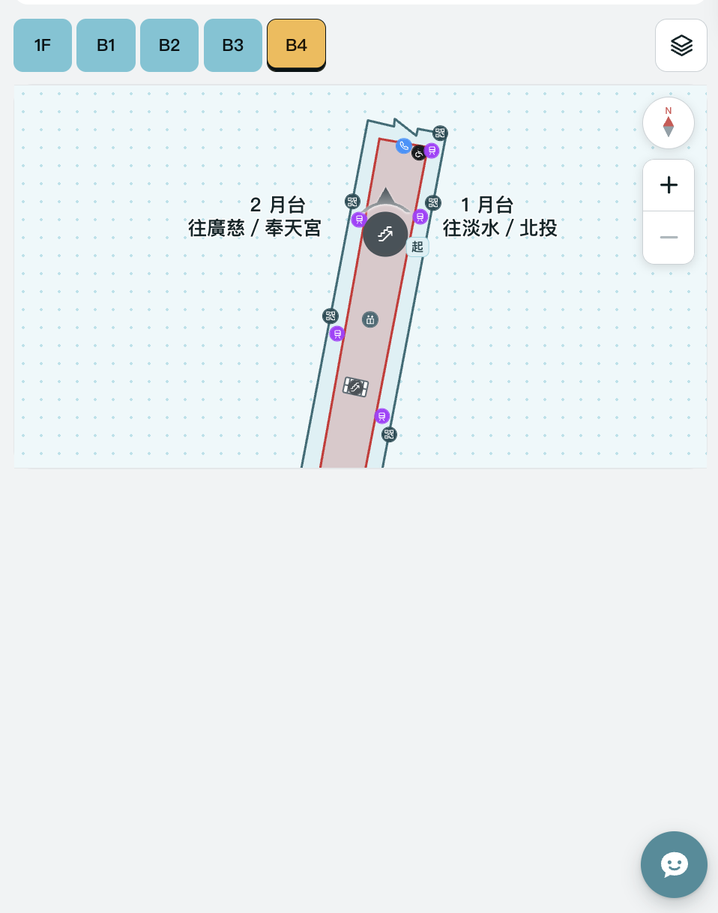
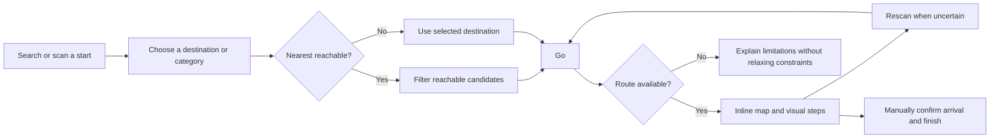
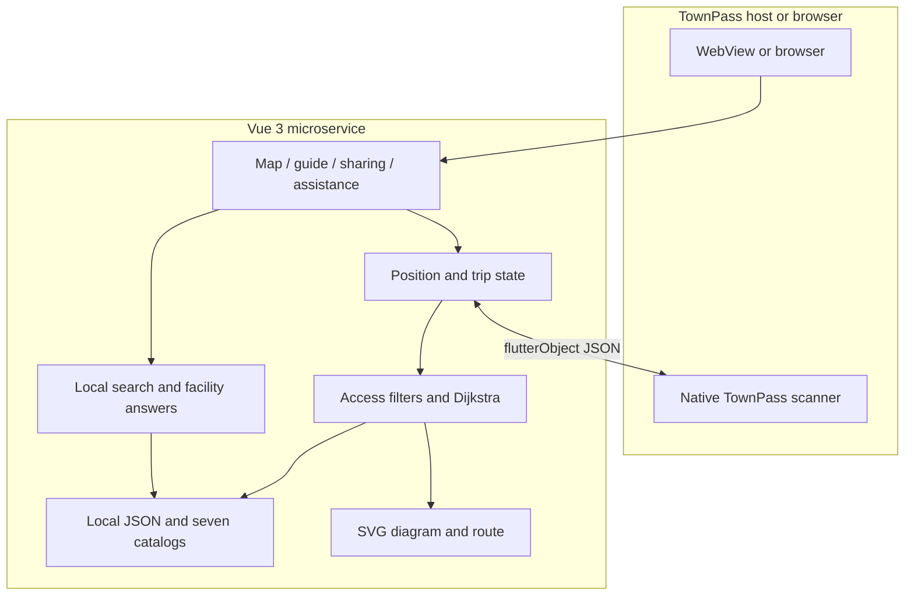
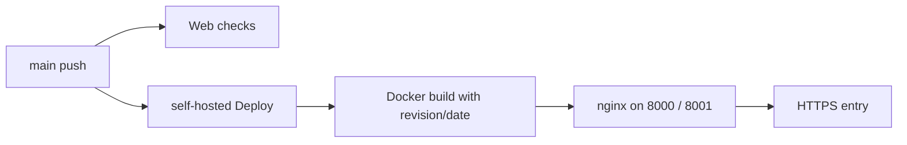

<div align="center">

# Taipei Main Station Wayfinding · 北車不迷路

**Find facilities, choose a reachable route, and follow readable visual directions inside TownPass.**

[繁體中文](./README.md) · **English**

[Try the service](https://codefest.yoyo899843.com/station-map) · [Changelog](./CHANGELOG.md) · [Contributing](./.github/CONTRIBUTING.md) · [Architecture](./.github/ARCHITECTURE.md)

</div>

A **TownPass WebView microservice** for Taipei Main Station: facility search, nearest reachable destinations, QR position recovery, inline visual guidance, and fixed meeting-place sharing. Search and routing use local data rather than a remote generative model. A browser supports manually selected endpoints; native QR scanning requires the TownPass bridge.

**`v0.1.0-rc.1` is a demonstration prerelease.** It includes a partial diagram-based graph and an integrated interaction flow, not a complete station survey, installed QR infrastructure, emergency navigation service, or certified wheelchair route.

## Contents

[Why](#why-this-project) · [Screenshot](#actual-screenshot) · [Features](#features-and-scope) · [Quick start](#quick-start) · [Walkthrough](#walkthrough-and-demo) · [Architecture](#architecture) · [Data](#data-and-coverage) · [Tests](#tests-and-quality) · [Deployment](#deployment-and-versioning) · [License](#provenance-and-licensing)

## Why this project

Station navigation involves more than finding a dot: a nearby restroom may be separated by a wall, a transfer may require a different floor, and a meeting place can be difficult to describe. The project connects these tasks into one recoverable flow.

| User need | Approach |
| --- | --- |
| Find a facility that can actually be reached | Rank candidates by allowed graph path cost, not straight-line proximity |
| Understand the next action without switching screens | Keep map, direction icon, landmarks and previous/next controls together |
| Recover when uncertain about position | Keep the destination, confirm a new QR position, then recompute |
| Reduce reading and language barriers | Seven languages, local synonyms, Zhuyin/large-text preferences and expandable information |
| Meet friends or explain a problem to staff | Share a fixed place and show a staff-facing assistance card |

These are design goals. No formal user study or measured percentage improvement has been established.

## Actual screenshot

<p align="center">
  
</p>

*Unretouched application screenshot supplied by the project owner, captured 2026-11-08 at 08:47 Asia/Taipei. It predates subsequent adaptive-height changes and is not evidence of current device validation. [Provenance](./assets/screenshots/README.md).*

## Features and scope

- **Searchable endpoints:** collapsible floor groups, category/name/operator/exit-code/number matching, multilingual synonyms and bounded typo tolerance.
- **Nearest reachable facilities:** reuse the selected start and route restrictions; one primary Go action.
- **Step-free routing:** remove stairs, escalators and unknown accessibility edges before routing; do not silently relax constraints.
- **Inline guidance:** floor polylines, direction icons, landmarks, floor transitions and previous/next steps beside a map with adaptive height.
- **QR recovery:** a small confirmation dialog invokes existing single-scan TownPass capability. Cancellation preserves the trip.
- **Sharing and assistance:** share either fixed endpoint, show a staff card, rescan/cancel from the lower control group, and explicitly confirm arrival.
- **Reading preferences:** standard, child and elder modes; Zhuyin, larger text, themes and reduced-motion handling.
- **Seven local catalogs:** Traditional Chinese, English, Vietnamese, Indonesian, Thai, Korean and Japanese.
- **Local facility helper:** factual station-data answers, progress events, incremental text and facility cards; suggestions remain reusable.

Still pending: full-station connectivity, field checks, installed QR labels, translation review, complete audio assets, Android/iPhone WebView and assistive-technology validation, and fresh-install offline behavior. Historical optional Gemma/voice integration is not proof of tested on-device inference, native token streaming or microphone behavior. Multiple “fastest/easiest to understand” route comparison is also unfinished.

## Quick start

Verified tooling baseline: **Node.js 20, npm and Git**. The web flow does not require Flutter, model weights, an API key, an account or a database.

```bash
git clone https://github.com/yoyo899843/CodeFest-2026-Taipei-Maze.git
cd CodeFest-2026-Taipei-Maze/app
npm ci
npm run serve -- --host 127.0.0.1 --port 8082
```

Open <http://127.0.0.1:8082/>. `/` redirects to `/station-map`; `/about` provides source/version/license information; `/meet` is the meeting-place entry. Historical test/orientation routes redirect to the station map.

### Browser versus TownPass

Browsers support manual endpoints, search, routing, map interaction, steps, fixed-point sharing and local facility answers. Inside TownPass, `flutterObject` calls `qr_code_scan`. Without the bridge, select a start manually. **GPS is not indoor QR positioning; scanning is not a guaranteed persistent camera session; the page does not know the phone's heading.**

This is not a separate Flutter navigation app. Do not modify the adjacent TownPass checkout for routine web changes. [Historical integration notes](./integration/townpass/README.md) describe experiments, not guarantees about the official host.

## Walkthrough and Demo



1. Select a start and destination; optionally swap or share either point. An existing start does not require another scan.
2. For nearby facilities, choose a category and enable Nearest reachable. Enable Step-free route when needed.
3. Select Go. Compare the map, direction and landmarks. Advancing a step does not update actual position.
4. Rescan if uncertain; manually confirm arrival and finish without fabricating a new QR position.

| Scenario | Start → destination | Conditions / expected result |
| --- | --- | --- |
| Same-floor restroom | `b1-e4` → `b1-wc-m5` | Ordinary route succeeds |
| Short floor transfer | `b3-info` → `b4-e2` | Ordinary route succeeds |
| Elevator transfer | `b3-e2` → `b4-e2` | Step-free model route succeeds |
| B4 wheelchair waiting area to M8 | `b4-wait-n` → `b1-exit-m8` | Enable step-free; 12 steps; ends at the **B1 exit point, not a verified street-level exit** |
| Conservative refusal | `b1-e4` → `b1-wc-m5` | Step-free returns no route; insufficient data does not prove actual inaccessibility |

[Load B4 → M8 endpoints](https://codefest.yoyo899843.com/station-map?start=b4-wait-n&destination=b1-exit-m8), then explicitly enable step-free routing. `/station-map?demo=1` provides fixed scenarios, simulated movement and equipment outages. Keep simulation labels visible; these are not field-position evidence.

## Architecture



- **UI:** Vue 3, Vue Router, JavaScript ES modules, HTML/CSS and SVG. No new remote LLM, translation or TTS runtime dependency.
- **Routing:** expand compact JSON into a directed graph; apply hard access filters, then Dijkstra. Nearest-facility queries use the same restrictions.
- **Search:** Unicode normalization, a local synonym/intent dictionary and Optimal String Alignment; not embedding-based model search.
- **State:** QR, manual, link and Demo sources remain distinct. Manual arrival is tied to the current trip and invalidated by relevant changes.
- **Assistant:** internal `thinking`, `delta` and `done` events, not network SSE. Basic facility answers do not need a native model.
- **Delivery:** Docker multi-stage build to nginx static hosting; GitHub Actions web checks and deployment. No Flask backend is required.

### Repository layout

```text
.
├── app/
│   ├── src/
│   │   ├── components/     # reusable and station UI
│   │   ├── views/          # route-level composition and station diagrams
│   │   ├── station/        # diagram graph, routing, position and place sharing
│   │   ├── navigation/     # core routing/bridge primitives and test fixture
│   │   ├── search/         # local multilingual search
│   │   ├── chat/           # local answers, stream events and native adapter
│   │   ├── display/        # reading preferences and Zhuyin
│   │   ├── i18n/           # seven catalogs and place names
│   │   ├── meeting/        # fixed meeting-place data and logic
│   │   └── staff/          # assistance data
│   ├── tests/              # Node and Vue renderer regression tests
│   ├── scripts/            # asset validation and graph generation
│   └── Dockerfile
├── assets/screenshots/     # actual screenshot and provenance
├── data/                   # attributed research snapshots and source index
├── tools/                  # data, QR, bundle and model maintenance tools
├── integration/townpass/   # historical patches, diagnostics and notices
├── scripts/                # opt-in historical host tooling
├── .github/                # CI and contributor/architecture/security guides
├── compose.yml
├── README.md               # default Traditional Chinese documentation
├── README.en.md
└── docs/                   # local only; ignored and absent from fresh clones
```

See [Architecture](./.github/ARCHITECTURE.md) for contracts and boundaries. Local competition proposals, reports and the reference PDF remain on the original developer machine. Public development instructions do not depend on them. Ignoring `docs/` does not remove old commits.

## Data and coverage

| Floor | Displayed places | Bound to walking graph |
| --- | ---: | ---: |
| 1F | 46 | 0 |
| B1 | 44 | 41 |
| B2 | 86 | 32 |
| B3 | 35 | 35 |
| B4 | 17 | 17 |
| **Total** | **228** | **125** |

Graph version: `2026.11.08-diagram`; 19 recorded floor connections. Coverage does not establish mutual reachability or field verification of every device/direction. Costs use **relative diagram units**, not surveyed meters or estimated seconds. 1F, B2 railway platforms and some B1 points remain unbound.

Sources and roles:

- **Taipei Metro station plans, facilities and cross-sections:** relative floor, corridor and equipment geometry.
- **TRA/THSR official plans:** railway platform order and equipment checks; preserve red/purple markers without fabricating track crossings.
- **Taipei Open Data:** 10 official CSV research snapshots and station subsets; a 48-source index does not mean 48 live integrations.
- **Owner-supplied 1F plan photograph:** diagram reference only; the original photo is not bundled and derivative rights review remains pending.

[Research data](./data/README.md) · [Attribution](./data/ATTRIBUTION.md) · [Source catalog](./data/SOURCE_CATALOG.md) · [Third-party notices](./THIRD_PARTY_NOTICES.md)

```bash
cd app
npm run build:walking
npm run validate:assets
```

Do not inflate coverage by snapping across unknown space or inventing connector endpoints. Step-free access needs separate evidence for corridors, entrances, facilities and exit-to-street segments.

## Tests and quality

```bash
cd app
npm test
npm run lint
npm run validate:assets
npm run build
cd ..
python3 -m unittest discover -s tools -p 'test_*.py'
git diff --check
```

The Web checks workflow runs web and Python tooling checks. Tests cover routes/restrictions, search, bridge state, location links, sharing, trip completion and Vue renderer output. Production files are in `app/dist/`. These tests do not replace browser visuals, native camera, screen-reader, lifecycle or field-route validation.

Dependency audit on 2026-11-08: `npm audit --omit=dev` reported no runtime advisories; the full audit still reported 18 development-toolchain findings (8 high, 10 moderate). This prerelease does not force potentially breaking upgrades/downgrades; Vue CLI toolchain modernization remains pending. Bind the development server to loopback and serve production through nginx. Audit results are not a security guarantee.

## Deployment and versioning

```bash
export CODEFEST_COMMIT="$(git rev-parse HEAD)"
export CODEFEST_BUILD_DATE="$(date -u +%Y-%m-%d)"
docker compose up -d --build
```

Compose exposes ports `8000` and `8001`. Deployment-side HTTPS uses the existing Cloudflare Tunnel or reverse proxy; credentials are not included. The main-push Deploy workflow pulls, builds, starts services and checks both ports. Web checks run independently and do not gate deployment; run local checks before pushing.

Production builds receive the source revision/date, and the information page links to matching source. A direct `docker build app` without revision arguments retains an unknown version instead of inventing a SHA.



The Android integration workflow is a historical opt-in host check, not proof of current official-host changes or device validation. Model publishing has separate terms; model weights are not web prerelease assets.

## Roadmap

1. Field-check a continuous area, including equipment, entrances and QR placement.
2. Validate Android/iPhone WebView, lifecycle, assistive technology and reading modes.
3. Review all translations and separately verify audio/offline behavior.
4. Establish equipment-closure, construction and label-inspection responsibilities.
5. Evaluate cognitive multi-route comparison, on-device models and other public venues.

## Contributing and security

Read [Contributing](./.github/CONTRIBUTING.md) and [Security](./.github/SECURITY.md). Reports should include revision, device, locale/mode, point IDs, route options and reproduction steps. Do not publish personal data, tokens or private scan contents. Use English Conventional Commits and the open-source PR template.

## Provenance and licensing

Original project code is **AGPL-3.0-or-later**: [LICENSE](./LICENSE), [AGPL_NOTICE](./AGPL_NOTICE.md). TownPass and third-party code, data, map derivatives, models and documents retain their own rights; they are not all relicensed under AGPL.

Research CSV attribution is recorded in [data/ATTRIBUTION.md](./data/ATTRIBUTION.md). Imported prototype code and some map derivatives still require redistribution-rights review. Repository access and a prerelease label do not establish clearance or completion of every delivery obligation. Untracking `docs/` does not remove historical PDFs or other old content; release review must include history.

Thanks to TownPass, Taipei Metro, TRA, THSR and Taipei Open Data for references and foundations. These names do not imply official endorsement or approved deployment.
