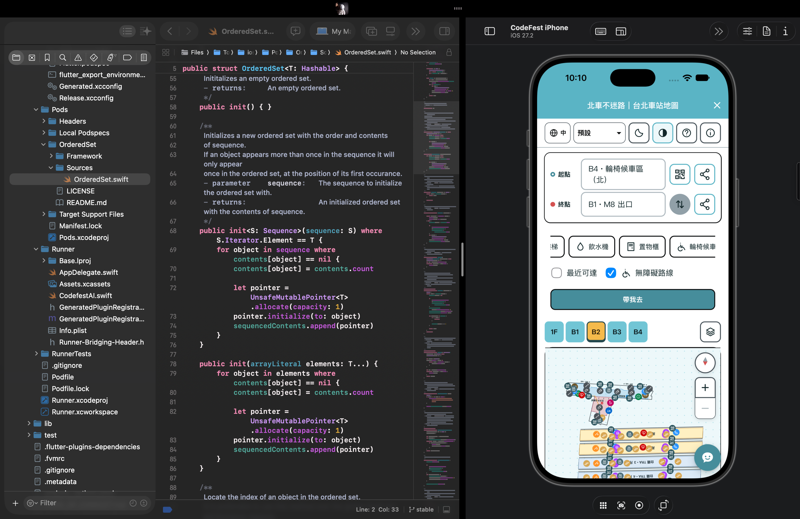
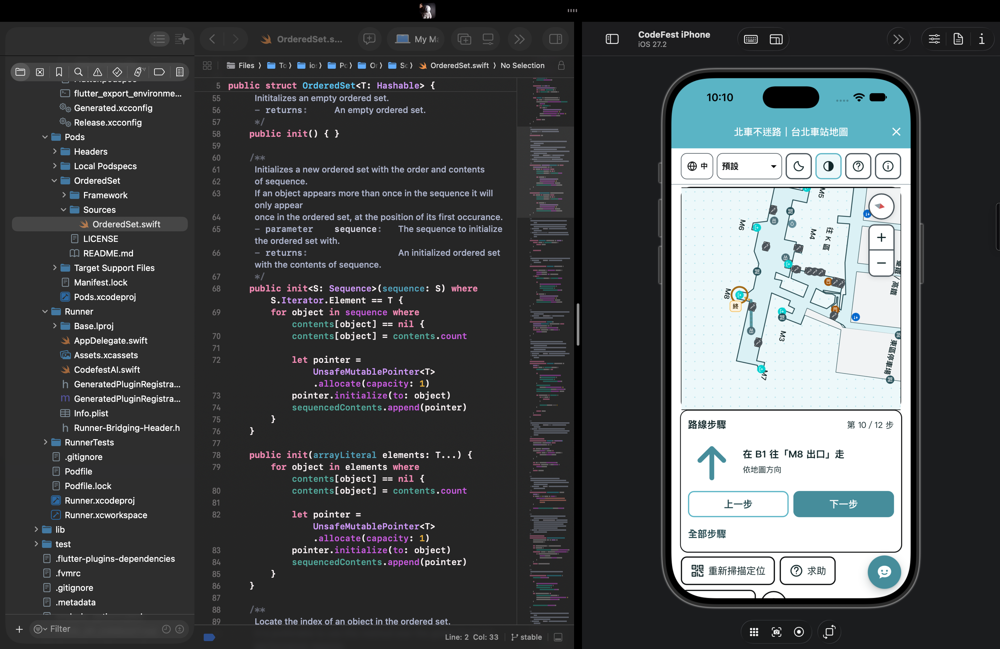
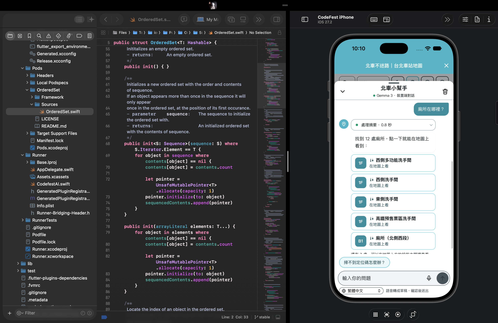
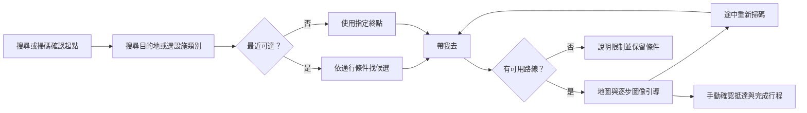
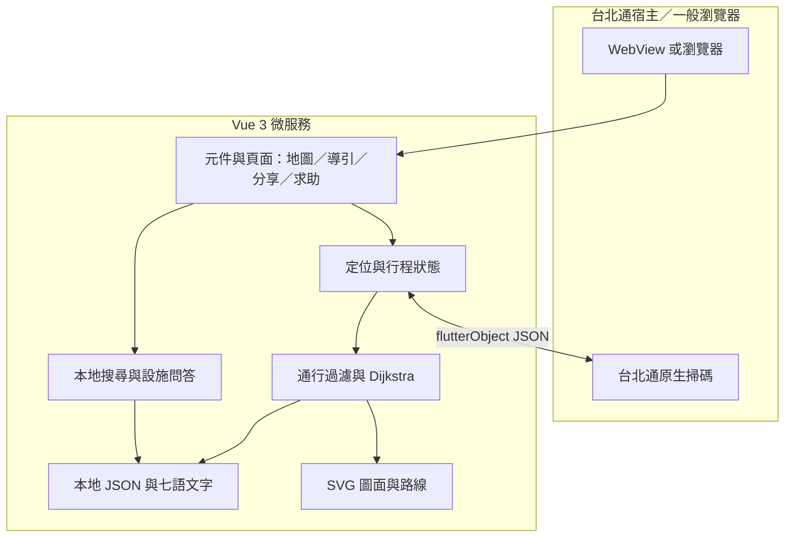
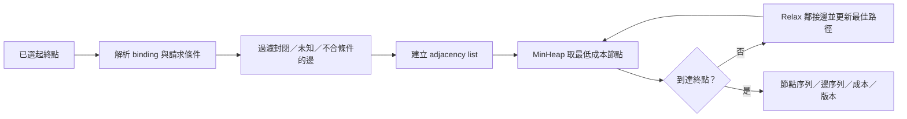
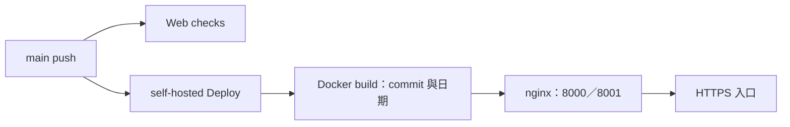

<div align="center">

# 北車不迷路

**在台北通裡找設施、選路線，用看得懂的指引穿過台北車站。**

**繁體中文** · [English](./README.en.md)

[線上體驗](https://codefest.yoyo899843.com/station-map) · [版本紀錄](./CHANGELOG.md) · [參與開發](./.github/CONTRIBUTING.md) · [架構指南](./.github/ARCHITECTURE.md)

</div>

我們打造「北車不迷路」，希望讓走進台北車站的人更容易找到設施、理解路線，也能在不確定位置時重新出發。我們將服務整合成 **台北通 TownPass WebView 微服務**，把搜尋、最近可達路線、QR 重新定位、圖像指引與集合點分享放在同一個操作流程中。

我們以本地資料完成核心搜尋與路徑計算；你可以先用一般瀏覽器選擇起終點體驗，再透過台北通的原生橋接使用掃碼。

我們已推出 **`v0.1.0-rc.1` 預發行版**，完成局部路網與主要操作流程。目前我們仍在補齊全站資料與現地驗證，服務尚不適用於緊急避難或作為輪椅通行認證。

## 內容導覽

[解決的問題](#解決的問題) · [實際畫面](#實際畫面) · [功能](#功能與完成範圍) · [快速開始](#快速開始) · [操作與-demo](#操作與-demo) · [技術架構](#技術架構) · [最短路徑](#我們如何計算最短路徑) · [資料與路網](#資料與路網) · [測試](#測試與品質) · [部署](#部署與版本) · [授權](#授權與致謝)

## 解決的問題

台北車站的尋路任務往往是「想去廁所，卻不知道哪一個走得到」「知道目的地，卻不確定在哪裡換樓層」「與朋友約好，卻說不清楚集合點」。我們把這些任務接成一條連續流程，讓人每次只需確認下一個行動。

| 遇到的困難 | 我們的做法 |
| --- | --- |
| 圖上最近的設施，可能隔牆或不互通 | 依可通行路徑搜尋「最近可達」，並沿用通行限制 |
| 讀圖與跨樓層需要反覆切換資訊 | 地圖、方向圖示、地標、上一步／下一步放在同頁 |
| 途中迷路，不知道怎麼恢復 | 保留目的地，以 QR 再次確認當下位置並重算 |
| 字小、長文字或語言增加負擔 | 七語、本地詞典、注音／大字偏好、說明收進資訊視窗 |
| 集合地點與求助難描述 | 分享固定起點／目的地，提供給站務看的溝通卡 |

我們接下來會透過任務完成率、找路時間與求助次數，檢驗這些設計是否確實降低使用負擔。

## 實際畫面

<p align="center">
  
</p>

*我們以這張 B4 操作畫面呈現樓層切換、設施與地圖控制；拍攝時間為 2026-11-08 08:47（臺北時間），早於自適應高度更新。[截圖紀錄](./assets/screenshots/README.md)。*

### iPhone 模擬器實際操作

我們在以下三張 iPhone 模擬器畫面中展示選路、逐步導引與設施問答。拍攝時間為 2026-11-08 10:10（臺北時間），點開即可查看完整操作畫面。

<details>
<summary>起終點與無障礙路線：B4 輪椅候車區（北）→ B1 M8 出口</summary>

[](./assets/screenshots/ios-endpoints-step-free.png)

</details>

<details>
<summary>地圖與方向同頁：第 10／12 步、上一步／下一步、重掃與求助</summary>

[](./assets/screenshots/ios-inline-route-steps.png)

</details>

<details>
<summary>小幫手：設施回答、樓層卡片與可繼續點選的建議問題</summary>

[](./assets/screenshots/ios-local-facility-helper.png)

</details>

## 功能與完成範圍

- **搜尋起點與終點：** 樓層選單可收合，支援設施類別、出口碼、部分名稱、編號、多語同義詞與有界錯字容忍。
- **找最近設施：** 選類別、勾「最近可達」，已有起點即可直接按「帶我去」，不用重掃。
- **無障礙路線：** 先排除樓梯、電扶梯及未知可及性路段，再求解；找不到時保留原因，不自動放寬條件。
- **同頁導航：** 路徑、地圖、大方向圖示、沿途地標、樓層切換與前後步驟集中呈現，地圖依可用空間調整高度。
- **重新定位：** 小型確認框後呼叫台北通單次掃碼；取消保留行程，成功後依新位置重算。
- **分享、求助與完成：** 起終點可分別分享固定地點，底部集中重掃／求助／取消；最後可手動確認抵達並結束行程。
- **閱讀與語言偏好：** 預設／兒童／長輩模式、注音、大字、主題與減少動態效果；繁中、英文、越南文、印尼文、泰文、韓文、日文。
- **本地小幫手：** 設施問答、處理狀態、逐段文字與設施卡片；其他建議問題可繼續點選。

我們目前優先完成路網核對、七語校對與 Android／iPhone WebView 驗證；完整語音、離線啟動與多候選路線比較則列在後續工作中。下方的[已知限制與後續方向](#已知限制與後續方向)說明我們的驗證範圍。

## 快速開始

我們使用 **Node.js 20、npm 與 Git** 開發及驗證網頁。你可以直接啟動搜尋與導航流程，無須先準備 Flutter、模型權重、API key 或資料庫。

```bash
git clone https://github.com/yoyo899843/CodeFest-2026-Taipei-Maze.git
cd CodeFest-2026-Taipei-Maze/app
npm ci
npm run serve -- --host 127.0.0.1 --port 8082
```

開啟 <http://127.0.0.1:8082/>。根路徑會導向 `/station-map`；`/about` 提供來源、版本與授權，`/meet` 提供集合點入口。舊測試／箭頭頁網址會導回正式地圖。

### 瀏覽器與台北通的差別

我們讓搜尋、選路、地圖、步驟、固定點分享及本地設施問答在瀏覽器中就能使用；進入台北通後，再透過 `flutterObject` 呼叫 `qr_code_scan`。沒有橋接時，你仍能手動選擇起點。

我們以 QR 確認掃碼當下的位置，方向圖示則對應地圖方位。這套流程目前不使用 GPS 作室內定位，也不持續追蹤手機位置或朝向。

我們把導航介面與核心維持在網頁端，沿用台北通已有的原生掃碼能力。[TownPass 整合說明](./integration/townpass/README.md)記錄橋接與選配能力的範圍。

## 操作與 Demo



1. 選起點與終點，可對調、分享；已選好起點就不必再掃碼。
2. 若要最近設施，選「廁所」等類別並勾「最近可達」；需要避階梯時勾「無障礙路線」。
3. 按「帶我去」，在同頁對照地圖、方向和地標；上一步／下一步只瀏覽步驟，不代表位置自動更新。
4. 不確定位置時重新掃碼；完成時按「我已抵達」與「完成行程」，不偽造新的 QR 位置。

### 可重現情境

| 情境 | 起點 → 終點 | 條件／預期 |
| --- | --- | --- |
| 同層找廁所 | `b1-e4` → `b1-wc-m5` | 一般路線成功 |
| 簡短跨樓層 | `b3-info` → `b4-e2` | 一般路線成功 |
| 電梯跨層 | `b3-e2` → `b4-e2` | 勾無障礙路線，模型成功 |
| B4 輪椅區到 M8 | `b4-wait-n` → `b1-exit-m8` | 勾無障礙路線，共 12 步；終點是 **B1 出口點，非已驗證地面出口** |
| 資料不足時拒絕 | `b1-e4` → `b1-wc-m5` | 勾無障礙路線，預期無路線；不代表現場必定不可及 |

[載入 B4 → M8 起終點](https://codefest.yoyo899843.com/station-map?start=b4-wait-n&destination=b1-exit-m8)，再手動勾選無障礙路線。`/station-map?demo=1` 提供固定情境、位置模擬與設備停用操作，**須保留模擬標示**，不當作現地定位證據。

## 技術架構



- **前端：** 我們以 Vue 3、Vue Router、JavaScript ES Modules、HTML／CSS 與 SVG 組合互動介面。
- **導航：** 我們將 Compact JSON 展開成有向圖，先套通行限制，再以 Dijkstra 求路；最近設施沿用相同條件。
- **搜尋：** 我們以 Unicode 正規化、本地詞典、同義詞／意圖與 Optimal String Alignment 處理查詢。
- **狀態：** 我們分開管理 QR、手動起點、連結與 Demo，讓手動抵達只適用於當前行程。
- **小幫手：** 我們以內部 `thinking`／`delta`／`done` 事件呈現本地設施回答，保持查詢與畫面更新解耦。
- **部署：** 我們透過 Docker 多階段建置輸出 nginx 靜態網站，以 GitHub Actions 執行檢查與部署。

### 專案結構

```text
.
├── app/
│   ├── src/
│   │   ├── components/     # 共用及場域元件
│   │   ├── views/          # 地圖／集合／資訊頁與站圖資料
│   │   ├── station/        # 真實圖面模型、路線、定位與分享
│   │   ├── navigation/     # 導航核心、橋接、合成測試 fixture
│   │   ├── search/         # 本地多語搜尋
│   │   ├── chat/           # 設施回答與串流介面
│   │   ├── display/        # 字級、注音與閱讀偏好
│   │   ├── i18n/           # 七語介面與地點名稱
│   │   ├── meeting/        # 固定集合點資料及邏輯
│   │   └── staff/          # 站務求助資料
│   ├── tests/              # Node／Vue renderer 回歸測試
│   ├── scripts/            # 資產驗證與步行圖產生器
│   └── Dockerfile          # 網頁建置及 nginx runtime
├── assets/screenshots/     # 實際截圖及來源
├── data/                   # 官方研究副本、顯名與來源索引
├── tools/                  # 資料、QR、封裝與模型維護工具
├── integration/townpass/   # 歷史宿主 patch、診斷頁與授權
├── scripts/                # 選配歷史宿主環境 helper
├── .github/                # CI、貢獻／架構／安全文件
├── compose.yml
├── README.md               # 中文主頁
└── README.en.md            # 英文版
```

我們依功能分離導航、搜尋、定位與呈現邏輯，讓各模組可以獨立驗證與維護。完整分層與資料契約見 [Architecture](./.github/ARCHITECTURE.md)。

### 我們如何計算最短路徑

我們把站內導航表達為帶權重的有向圖 `G = (V, E)`：節點代表設施、走道轉折與設備對端；邊代表走道或跨樓層連線。使用者選擇的點位 ID 先透過 binding 對到節點，再進入求路流程。

目前圖資料展開後有 **359 個節點、3162 條有向邊**，包含 1562 組走道連線與 38 條跨層有向邊；其中只有 125 個節點綁定可選地點，其餘多為入口與轉折輔助點。我們不把這些輔助節點全部顯示為設施或 QR 定位點。

#### 1. 從圖面產生可通行圖

我們在修改圖面來源後，以 `npm run build:walking` 執行[步行圖產生器](./app/scripts/build-walking-network.mjs)；一般 `npm run build` 只建置網頁，不會自動重建路網：

1. 讀取各層可行走多邊形，將牆外或其他場域的 context 區域作為排除區。
2. 把可綁定的設施放入圖中，並在牆角內側產生輔助轉折點。
3. 檢查同層節點間的線段，普通走道邊必須通過 `segmentInWalkAreas` 與圖面淨距檢查。
4. 讓每個節點選取最近的最多 8 個可視鄰居，再去除重複連線；其他節點也可能連回它，因此最終鄰接數不一定限制為 8。
5. 對圖示略偏離走道的設施，另建立短的推定入口邊，並將可及性標為未知；這類推定入口不會通過無障礙過濾。
6. 只依既有設備對端資料加入跨層邊，最後驗證 ID、正成本、樓層、來源與通行欄位。

我們把一組雙向走道壓成一筆 compact 記錄，執行時才展開正反兩條邊，降低重複資料。這是稀疏的圖面模型；Dijkstra 找到的是**這張圖中的最短成本路徑**，不代表連續平面上的幾何最短線，也不代表現場所有通道都已建入。

#### 2. 我們怎麼定義成本

我們目前使用以下圖面成本：

```text
走道成本 = round(hypot(x₂ − x₁, y₂ − y₁), 1 位小數)
電梯跨層成本 = 120
樓梯／電扶梯跨層成本 = 90
路線成本 = 所有通行邊成本的總和
```

我們用固定跨層成本表達設備切換的額外代價；這些數值尚未由實際步行、候梯或人流時間校準。因此，我們把結果稱為最短「圖面成本」路徑，而不把它換算成最快分鐘數。

需要無障礙時，我們直接排除不適合的邊，而不是只給樓梯一個很大的懲罰。這能避免系統在「其他路很遠」時仍選中樓梯。

#### 3. 先過濾，再跑 Dijkstra

我們在[路網路由器](./app/src/station/walking.mjs)中，依每次請求建立可用邊集合：

| 條件 | 我們的處理 |
| --- | --- |
| 非 `open`、`verification === "unverified"` | 排除 |
| 需要票券，但請求未允許 | 排除；目前票閘／付費區資料仍未完整建模 |
| 屬於使用者排除的邊型別 | 排除 |
| 設備 ID 被列為停用 | 排除 |
| 勾選無障礙，但邊為樓梯／電扶梯 | 排除 |
| 勾選無障礙，但 `stepFree` 或 `wheelchairPassable` 不明確為 `true` | 排除 |

我們允許圖面核對層級的邊進入模型，但不把 `desk_checked` 寫成現地驗證。這也讓一般路線與無障礙路線能共用同一份圖，僅在求路前建立不同的可用子圖。



#### 4. Dijkstra 的實作細節

我們在[核心模組](./app/src/navigation/dijkstra.mjs)中使用 adjacency list、`MinHeap`、最佳候選 `best` 與已確定節點 `settled`：

- 我們將起點成本設為 0，優先取出累積成本最小的候選。
- 對每條鄰接邊做 relaxation：`candidate = current.cost + edge.cost`；若更好，就更新並放進 heap。
- 我們採 lazy update，不在 heap 中原地修改舊項目；取出已被較佳候選取代的項目時直接跳過。
- 我們以 `1e-9` 處理近似相等的成本，並以邊 ID 組成的路徑鍵做穩定決定，讓等價候選的結果可以重現。
- 我們在取出終點時回傳路線；佇列耗盡則回傳 `NoRoute`，成本累加非有限值則回傳 `InvalidGraph`。

以 `V` 為節點、`E` 為有向邊，lazy-heap 版本的基本佇列工作可概括為 `O((V + E) log E)`。我們目前也保存候選的節點／邊陣列與路徑鍵，因此另有隨路徑長度增加的複製、比較及記憶體成本，不能直接把它當成只有距離陣列的教科書實作。

我們選擇這個版本，是為了讓目前規模下的結果與除錯紀錄容易追蹤。擴大場域時，我們會評估以前驅索引重建路徑、重用 adjacency list，以及量測真機延遲與記憶體。A* 則需要與成本模型相容的啟發式；目前我們尚未實作，也不把更換演算法當成補齊資料的替代方案。

### 我們如何找「最近可達」

我們先依類別與 `enabled` 取出候選；無障礙請求還要求設施的 `accessibleFacility === true`。接著對每個候選套用同一組路線條件，排除無路可達者，再依路線成本排序，成本相同時以 point ID 穩定排序。

```text
候選設施 → 相同起點與通行限制 → 逐一求路
         → 保留成功路線 → 依 graph cost 排序 → 取前 k 個
```

我們目前採逐候選求路，`K` 個候選大約會執行 `K` 次單點求路，再加上排序成本；因此沒有宣稱最近查詢只需一次 Dijkstra。候選增加時，我們可改用同一起點的單源最短距離結果服務多個終點；若要跨使用者或大量起點找同類設施，也可再評估反向圖的多源搜尋。

這套條件分成兩層：**走得到設施附近**與**設施本身符合需求**。我們不會因設施叫做電梯或廁所，就自動把所有入口判定成輪椅可通行。

### 我們如何把路徑變成圖像指引

我們將路由結果交給[呈現模組](./app/src/station/walk-route.mjs)，產生每層 polyline 與 `walk`／`floor`／`arrive` 三種步驟。

- 我們依命名地標或至少 **35°** 的圖面轉折切開步行段，並忽略短於 **2 個圖面單位** 的微小向量，減少座標雜訊造成的假轉彎。
- 我們讓高亮折線停在實際轉折點，說明文字則指向可辨識的下一個地標，不把 `corner-*`、`*-entrance` 等內部 ID 暴露成定位設施。
- 遇到跨層邊時，我們先結束本層步行段，再顯示搭乘設備、目標樓層與上下方向；不在不同樓層間畫一條平面直線。
- 我們以 `atan2(Δx, -Δy)` 產生地圖方位角：0° 為圖面上方，順時針增加。這是地圖方位，不是手機羅盤的實測朝向。
- 我們以目前可視高度、地圖位置與下方控制區實際大小調整地圖高度，保留地圖為主要視覺區域；擁擠時讓頁面自然捲動。

因此，連續幾步可能朝向同一個命名設施，但高亮的是不同走道轉折；我們用實際幾何切步驟，不靠固定句數播放導航。

### 我們如何處理多語搜尋與錯字

我們在[搜尋模組](./app/src/search/search.mjs)中先做 NFKC 正規化、大小寫與空白整理，再結合樓層解析、詞典同義詞、意圖與名稱／出口碼比對；符合條件的未命中查詢才進入模糊匹配。

我們以 **Optimal String Alignment** 計算 Unicode 字元的插入、刪除、替換與相鄰交換成本。每次比對長度 `m × n` 的字串，需要 `O(mn)` 工作；我們只保存最近幾列，而不建立完整距離矩陣。

目前模糊候選的規則是：

| 詞長 | 最大編輯距離 |
| --- | ---: |
| 小於 4 個字元 | 不做模糊容錯 |
| 4–7 個字元 | 1 |
| 8 個以上字元 | 2 |

我們另外要求編輯距離比例不超過 0.3，對代碼／編號類詞不做這種模糊修正，並以預設 **100,000 次 DP 儲存格工作量**作為一次搜尋的共用預算。預算耗盡時回傳 `incomplete`，模糊結果只列建議，未知修飾詞或多個意圖衝突則請求澄清。

搜尋結果先標記 `reachability: "unknown"`，再由路線引擎判定是否可達。這讓我們能把「詞語理解」與「通行證據」分開；搜尋核心對「最近」會要求進一步處理，介面則交給最近設施路由，不用名稱匹配假裝已完成路徑排序。

### 我們如何維持定位與行程一致

我們把 QR、手動起點、分享連結與 Demo 位置分開，並以行程身分綁定手動抵達記錄：起終點、定位 token、無障礙條件、排除邊型別或停用設備改變，舊確認就失效。

台北通舊掃碼橋接沒有 request ID，因此我們用共用 channel 管理同名請求：同時只允許一個 pending，逾時後進入 draining，先消化遲到回覆再允許新掃描。我們也處理 iOS 重複事件及 HMR／頁面重掛載，避免同一個回覆被誤用多次。

小幫手則透過本地 `thinking`、`delta`、`done` 事件傳遞處理摘要、文字與卡片。我們將停止與收合連到中止流程；這些 UI 事件和 QR 定位、原生模型 token streaming 是不同的契約。

<details>
<summary>在本機重現：B4 輪椅候車區到 M8 的無障礙求路</summary>

在 `app/` 目錄執行：

```bash
node --input-type=module <<'JS'
import { readFileSync } from "node:fs";
import {
  walkingRouter,
  planWalk,
  routeSteps,
} from "./src/station/walk-route.mjs";

const graph = JSON.parse(
  readFileSync("src/station/walking-network.json", "utf8")
);
const result = planWalk(walkingRouter(graph), {
  startId: "b4-wait-n",
  destinationId: "b1-exit-m8",
  stepFree: true,
});
console.log({
  status: result.type,
  cost: result.route?.cost,
  steps: routeSteps(result.route).length,
});
JS
```

目前圖版本的結果為 `success`、相對成本 `1316.7`、`12` 步。我們在這個範例中只規劃到 B1 的 M8 出口點；地面段仍需另行核對。

</details>

## 資料與路網

| 樓層 | 地圖點位 | 已綁定步行圖 |
| --- | ---: | ---: |
| 1F | 46 | 0 |
| B1 | 44 | 41 |
| B2 | 86 | 32 |
| B3 | 35 | 35 |
| B4 | 17 | 17 |
| **合計** | **228** | **125** |

我們目前維護 `2026.11.08-diagram` 圖版本，另整理 19 筆跨樓層資料。路徑成本使用**相對圖面單位**；我們尚未將它校準為公尺或步行時間。1F、B2 鐵路月台及部分 B1 仍待補圖，點位綁定也需要進一步核對實際通行關係。

我們依下列來源整理場域資料：

- **臺北捷運台北車站資訊圖、設施與剖面：** 圖面、走道與設備相對位置參考。
- **臺鐵／高鐵官方平面資料：** 鐵路月台順序及設備位置核對；保留紅色與紫色標記，不任意補跨軌道連線。
- **臺北市資料大平臺：** 10 份官方 CSV 研究副本及北車子集；48 項索引不代表全部已接入服務。
- **使用者提供的 1F 圖面照片：** 衍生示意參考，原照片未納入；權利審查未完成。

[研究資料說明](./data/README.md) · [顯名與授權](./data/ATTRIBUTION.md) · [來源索引](./data/SOURCE_CATALOG.md) · [第三方紀錄](./THIRD_PARTY_NOTICES.md)

```bash
cd app
npm run build:walking    # 修改來源後重建步行圖
npm run validate:assets # 確認資料、七語、QR 保留與圖產物一致
```

我們逐段核對走道、入口、設施與跨層對端，再擴充路網；無障礙路線也需要延伸到出口至地面的完整段落。

## 測試與品質

```bash
cd app
npm test
npm run lint
npm run validate:assets
npm run build
cd ..
python3 -m unittest discover -s tools -p 'test_*.py'
git diff --check
```

我們以 Web checks 執行網頁與 Python 工具檢查，涵蓋路徑／限制、搜尋、橋接狀態、定位連結、分享、抵達與 Vue renderer。建置產物位於 `app/dist/`；瀏覽器版面、手機相機、輔具、背景恢復與現地路線則另外驗證。

我們於 2026-11-08 執行相依安全稽核：runtime 套件未回報警示，開發工具鏈仍有 18 項（8 high、10 moderate），後續會處理 Vue CLI 工具鏈升級。我們將開發伺服器綁定 loopback，正式環境以 nginx 提供靜態檔案；詳細狀態見 [Security](./.github/SECURITY.md)。

## 部署與版本

```bash
export CODEFEST_COMMIT="$(git rev-parse HEAD)"
export CODEFEST_BUILD_DATE="$(date -u +%Y-%m-%d)"
docker compose up -d --build
```

我們以 Compose 提供 `8000` 與 `8001`，再由 Cloudflare Tunnel 或既有反向代理提供 HTTPS。部署 workflow 在 `main` push 後拉取、建置、啟動並檢查兩個埠。Web checks 與部署獨立執行，因此我們也會在推送前完成本地驗證。

我們在正式建置時將 commit 與日期傳入容器，讓資訊頁能連回對應原始碼。本機 Git checkout 可自動取得 SHA；容器若未收到 commit 且沒有 Git metadata，則顯示未知版本。



我們另外保留可手動執行的 Android 宿主整合檢查；原生模型、語音與裝置行為採獨立驗證流程。

## 已知限制與後續方向

我們目前的路線仍以圖面模型為基礎。QR 標牌尚未現地布設，手機模型／語音、完整音檔、七語人工校對及全新安裝離線能力仍待驗證；Gemma 介面標示不能單獨證明模型推論成功。我們會依以下順序推進：

1. 先挑連續區域完成現地走查、設備／入口／QR 核對，再擴大路網。
2. 補 Android／iPhone WebView、返回／背景、輔具與不同閱讀模式驗收。
3. 七語人工校對、完整語音資產與離線條件分別驗證。
4. 建立設備停用、施工與標牌巡查維護責任，未接即時資料前不承諾即時可用。
5. 再評估多候選認知友善路線、裝置端模型與更多公共場域。

## 參與與安全

我們歡迎透過 Issue 或 PR 一起改善服務，開發方式見 [Contributing](./.github/CONTRIBUTING.md) 與 [Security](./.github/SECURITY.md)。回報問題請附版本、裝置、語系／模式、起終點 ID、路線條件與重現步驟；不要貼個資、Token 或私人掃碼內容。Commit 使用英文 Conventional Commits，PR 沿用開源專案範本。

## 授權與致謝

我們以 **AGPL-3.0-or-later** 發佈原創程式碼，完整條款見 [LICENSE](./LICENSE) 與 [AGPL_NOTICE](./AGPL_NOTICE.md)。我們保留 TownPass 及第三方程式、資料、圖面與模型各自的授權；AGPL 不涵蓋所有第三方內容。

我們將研究資料顯名整理在 [data/ATTRIBUTION.md](./data/ATTRIBUTION.md)，並持續核對匯入原型與圖面衍生資料的再散布權利。各項來源、條款與審查狀態見 [THIRD_PARTY_NOTICES.md](./THIRD_PARTY_NOTICES.md)。

我們感謝 TownPass、臺北捷運、臺鐵、高鐵與臺北市開放資料提供參考與基礎。本作品由團隊開發，未代表上述單位的官方服務或背書。
