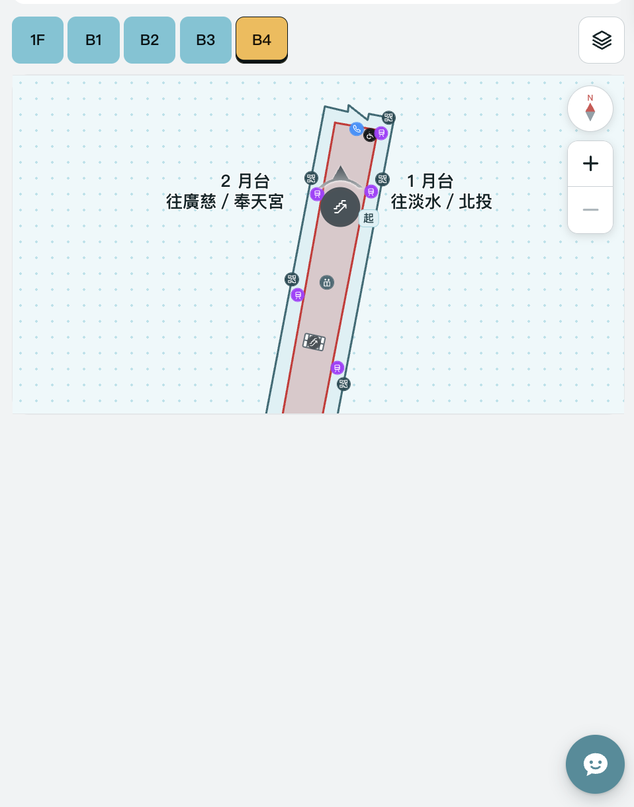
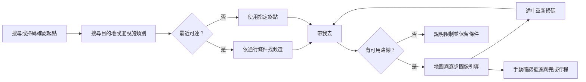
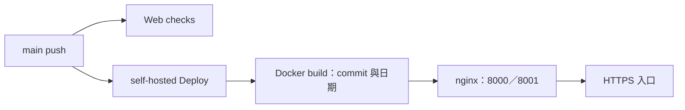

<div align="center">

# 北車不迷路

**在城市通裡找設施、選路線，用看得懂的指引穿過台北車站。**

**繁體中文** · [English](./README.en.md)

[線上體驗](https://codefest.yoyo899843.com/station-map) · [版本紀錄](./CHANGELOG.md) · [參與開發](./.github/CONTRIBUTING.md) · [架構指南](./.github/ARCHITECTURE.md)

</div>

北車不迷路是 **城市通 TownPass WebView 微服務**，以台北車站為場景，整合設施搜尋、最近可達路線、QR 重新定位、圖像化逐步導引與固定集合點分享。核心搜尋與路徑計算讀取本地資料，不依賴遠端生成式 AI；一般瀏覽器可用手動起終點體驗，原生掃碼則需城市通橋接。

目前為 **`v0.1.0-rc.1` 展示原型／預發行版**：已有局部圖面路網與完整操作流程，尚未完成全站測繪、現地 QR 布設及雙平台驗收，不作緊急避難或輪椅通行認證使用。

## 內容導覽

[解決的問題](#解決的問題) · [實際畫面](#實際畫面) · [功能](#功能與完成範圍) · [快速開始](#快速開始) · [操作與-demo](#操作與-demo) · [技術架構](#技術架構) · [資料與路網](#資料與路網) · [測試](#測試與品質) · [部署](#部署與版本) · [授權](#來源授權與公開交付)

## 解決的問題

台北車站的尋路任務往往是「想去廁所，卻不知道哪一個走得到」「知道目的地，卻不確定在哪裡換樓層」「與朋友約好，卻說不清楚集合點」。本作品把這些任務接成一條連續流程，讓人每次只需確認下一個行動。

| 遇到的困難 | 我們的做法 |
| --- | --- |
| 圖上最近的設施，可能隔牆或不互通 | 依可通行路徑搜尋「最近可達」，並沿用通行限制 |
| 讀圖與跨樓層需要反覆切換資訊 | 地圖、方向圖示、地標、上一步／下一步放在同頁 |
| 途中迷路，不知道怎麼恢復 | 保留目的地，以 QR 再次確認當下位置並重算 |
| 字小、長文字或語言增加負擔 | 七語、本地詞典、注音／大字偏好、說明收進資訊視窗 |
| 集合地點與求助難描述 | 分享固定起點／目的地，提供給站務看的溝通卡 |

這些是設計目標，目前未做正式使用者成效研究，也沒有宣稱改善找路時間或成功率的百分比。

## 實際畫面

<p align="center">
  
</p>

*使用者提供的實際開發截圖，拍攝於 2026-11-08 08:47（臺北時間），未修圖；呈現 B4 設施與地圖操作。此畫面早於後續自適應高度調整，不作最新裝置驗收證據。[截圖來源與範圍](./assets/screenshots/README.md)。*

## 功能與完成範圍

- **搜尋起點與終點：** 樓層選單可收合，支援設施類別、出口碼、部分名稱、編號、多語同義詞與有界錯字容忍。
- **找最近設施：** 選類別、勾「最近可達」，已有起點即可直接按「帶我去」，不用重掃。
- **無障礙路線：** 先排除樓梯、電扶梯及未知可及性路段，再求解；找不到時保留原因，不自動放寬條件。
- **同頁導航：** 路徑、地圖、大方向圖示、沿途地標、樓層切換與前後步驟集中呈現，地圖依可用空間調整高度。
- **重新定位：** 小型確認框後呼叫城市通單次掃碼；取消保留行程，成功後依新位置重算。
- **分享、求助與完成：** 起終點可分別分享固定地點，底部集中重掃／求助／取消；最後可手動確認抵達並結束行程。
- **閱讀與語言偏好：** 預設／兒童／長輩模式、注音、大字、主題與減少動態效果；繁中、英文、越南文、印尼文、泰文、韓文、日文。
- **本地小幫手：** 設施問答、處理狀態、逐段文字與設施卡片；其他建議問題可繼續點選。

**仍待完成：** 全站路網、現地走查、QR 設置、逐語校對、完整語音音檔、Android／iPhone WebView 驗收、輔具測試與全新安裝離線驗證。選配 Gemma／語音的歷史整合不代表手機推論、原生真串流或麥克風已雙平台通過。多候選「最快／最容易理解」比較也尚未完成。

## 快速開始

驗證環境為 **Node.js 20、npm、Git**。不需要 Flutter、模型權重、API key、帳號或資料庫即可執行網頁主流程。

```bash
git clone https://github.com/yoyo899843/Taipei-Codefest-2026-Big-Dumb.git
cd Taipei-Codefest-2026-Big-Dumb/app
npm ci
npm run serve -- --host 127.0.0.1 --port 8082
```

開啟 <http://127.0.0.1:8082/>。根路徑會導向 `/station-map`；`/about` 提供來源、版本與授權，`/meet` 提供集合點入口。舊測試／箭頭頁網址會導回正式地圖。

### 瀏覽器與城市通的差別

瀏覽器可操作搜尋、選路、地圖、步驟、固定點分享與本地設施回答。城市通內再透過 `flutterObject` 使用 `qr_code_scan`；沒有橋接時保留手動起點。**GPS 不作室內 QR 定位，相機不保證常駐掃描，網頁也不知道手機朝向。**

本專案不另外建立獨立 Flutter 導航 App。本輪開發不修改相鄰 TownPass checkout；[歷史整合資料](./integration/townpass/README.md) 只供理解既有實驗，不能直接等同官方宿主能力。

## 操作與 Demo



1. 選起點與終點，可對調、分享；已選好起點就不必再掃碼。
2. 若要最近設施，選「廁所」等類別並勾「最近可達」；需要避階梯時勾「無障礙路線」。
3. 按「帶我去」，在同頁對照地圖、方向和地標；上一步／下一步只瀏覽步驟，不代表位置自動更新。
4. 不確定位置時重新掃碼；完成時按「我已抵達」與「完成行程」，不偽造新的 QR 位置。

### 可重現情境

| 情境 | 起點 → 終點 | 條件／預期 |
| --- | --- | --- |
| 同層找廁所 | `b1-e4` → `b1-wc-m5` | 一般路線成功 |
| 簡短跨樓層 | `b3-info` → `b4-e2` | 一般路線成功 |
| 電梯跨層 | `b3-e2` → `b4-e2` | 勾無障礙路線，模型成功 |
| B4 輪椅區到 M8 | `b4-wait-n` → `b1-exit-m8` | 勾無障礙路線，共 12 步；終點是 **B1 出口點，非已驗證地面出口** |
| 資料不足時拒絕 | `b1-e4` → `b1-wc-m5` | 勾無障礙路線，預期無路線；不代表現場必定不可及 |

[載入 B4 → M8 起終點](https://codefest.yoyo899843.com/station-map?start=b4-wait-n&destination=b1-exit-m8)，再手動勾選無障礙路線。`/station-map?demo=1` 提供固定情境、位置模擬與設備停用操作，**須保留模擬標示**，不當作現地定位證據。

## 技術架構


- **前端：** Vue 3、Vue Router、JavaScript ES Modules、HTML／CSS、SVG；沒有新增遠端 LLM／翻譯／TTS 依賴。
- **導航：** Compact JSON 展開成有向圖，硬性通行過濾後以 Dijkstra 求路；最近設施沿用相同限制。
- **搜尋：** Unicode 正規化、本地詞典、同義詞／意圖及 Optimal String Alignment；不是大型模型語意嵌入。
- **狀態：** 真實 QR、手動起點、連結與 Demo 分開；手動抵達記錄綁定當前行程，變更條件後失效。
- **小幫手：** 內部 `thinking`／`delta`／`done` 事件，不是網路 SSE；基礎設施回答不依賴裝置端模型。
- **部署：** Docker 多階段建置 → nginx 靜態網站；GitHub Actions 執行 Web checks 與部署。主流程不需要 Flask 後端。

### 專案結構

```text
.
├── app/
│   ├── src/
│   │   ├── components/     # 共用及場域元件
│   │   ├── views/          # 地圖／集合／資訊頁與站圖資料
│   │   ├── station/        # 真實圖面模型、路線、定位與分享
│   │   ├── navigation/     # 導航核心、橋接、合成測試 fixture
│   │   ├── search/         # 本地多語搜尋
│   │   ├── chat/           # 設施回答與串流介面
│   │   ├── display/        # 字級、注音與閱讀偏好
│   │   ├── i18n/           # 七語介面與地點名稱
│   │   ├── meeting/        # 固定集合點資料及邏輯
│   │   └── staff/          # 站務求助資料
│   ├── tests/              # Node／Vue renderer 回歸測試
│   ├── scripts/            # 資產驗證與步行圖產生器
│   └── Dockerfile          # 網頁建置及 nginx runtime
├── assets/screenshots/     # 實際截圖及來源
├── data/                   # 官方研究副本、顯名與來源索引
├── tools/                  # 資料、QR、封裝與模型維護工具
├── integration/townpass/   # 歷史宿主 patch、診斷頁與授權
├── scripts/                # 選配歷史宿主環境 helper
├── .github/                # CI、貢獻／架構／安全文件
├── compose.yml
├── README.md               # 中文主頁
├── README.en.md            # 英文版
└── docs/                   # 本地文件；不納入 Git，fresh clone 不含此目錄
```

完整分層與資料契約見 [Architecture](./.github/ARCHITECTURE.md)。`docs/` 的提案、報告、PDF 仍保留於原開發機；公開開發不依賴這些本地檔案。Gitignore 不會清除舊提交內容。

## 資料與路網

| 樓層 | 地圖點位 | 已綁定步行圖 |
| --- | ---: | ---: |
| 1F | 46 | 0 |
| B1 | 44 | 41 |
| B2 | 86 | 32 |
| B3 | 35 | 35 |
| B4 | 17 | 17 |
| **合計** | **228** | **125** |

目前圖版本為 `2026.11.08-diagram`，另有 19 筆跨樓層資料記錄。點位覆蓋不代表所有點位互通，也不代表每筆設備方向與現況都已核對。路徑成本是**相對圖面單位**，不是已量測公尺或預估時間；1F、B2 鐵路月台及部分 B1 仍有路網缺口。

主要來源與角色：

- **臺北捷運台北車站資訊圖、設施與剖面：** 圖面、走道與設備相對位置參考。
- **臺鐵／高鐵官方平面資料：** 鐵路月台順序及設備位置核對；保留紅色與紫色標記，不任意補跨軌道連線。
- **臺北市資料大平臺：** 10 份官方 CSV 研究副本及北車子集；48 項索引不代表全部已接入服務。
- **使用者提供的 1F 圖面照片：** 衍生示意參考，原照片未納入；權利審查未完成。

[研究資料說明](./data/README.md) · [顯名與授權](./data/ATTRIBUTION.md) · [來源索引](./data/SOURCE_CATALOG.md) · [第三方紀錄](./THIRD_PARTY_NOTICES.md)

```bash
cd app
npm run build:walking    # 修改來源後重建步行圖
npm run validate:assets # 確認資料、七語、QR 保留與圖產物一致
```

不要靠放大吸附距離、穿牆或虛構設備對端提高覆蓋率。無障礙需分別核對沿途邊、入口、設施及出口到地面的段落。

## 測試與品質

```bash
cd app
npm test
npm run lint
npm run validate:assets
npm run build
cd ..
python3 -m unittest discover -s tools -p 'test_*.py'
git diff --check
```

Web checks workflow 執行上述網頁與 Python 工具檢查。測試涵蓋路徑／限制、搜尋、橋接狀態、定位連結、分享、抵達與 Vue renderer；建置產物在 `app/dist/`。單元測試不代替瀏覽器視覺、手機相機、螢幕閱讀器、背景恢復或現地路線驗證。

相依安全稽核（2026-11-08）：`npm audit --omit=dev` 未回報 runtime 套件弱點；完整稽核仍有 18 項開發工具鏈警示（8 high、10 moderate）。本版沒有以破壞性強制升降版處理，升級 Vue CLI 工具鏈列為後續工作。開發伺服器僅綁定 loopback，正式部署使用 nginx；稽核結果不構成安全保證。

## 部署與版本

```bash
export CODEFEST_COMMIT="$(git rev-parse HEAD)"
export CODEFEST_BUILD_DATE="$(date -u +%Y-%m-%d)"
docker compose up -d --build
```

Compose 對外提供 `8000` 與 `8001`，HTTPS 由部署端 Cloudflare Tunnel 等既有反向代理處理，repo 不包含憑證。部署 workflow 在 `main` push 後拉取最新版本、建置、啟動並檢查兩個埠；Web checks 是獨立工作，不是部署的前置閘門，推送前仍需本地驗證。

正式建置將 commit 與日期傳入容器，資訊頁可連到對應原始碼；直接 `docker build app` 而沒有傳入版本時，畫面會保留未知版本，不假造 SHA。



`.github/workflows/native-android.yml` 為選配歷史宿主整合檢查，不代表本次已修改或驗收官方宿主；模型發佈流程與權重另有條款，不屬於本版網頁 release asset。

## 已知限制與後續方向

1. 先挑連續區域完成現地走查、設備／入口／QR 核對，再擴大路網。
2. 補 Android／iPhone WebView、返回／背景、輔具與不同閱讀模式驗收。
3. 七語人工校對、完整語音資產與離線條件分別驗證。
4. 建立設備停用、施工與標牌巡查維護責任，未接即時資料前不承諾即時可用。
5. 再評估多候選認知友善路線、裝置端模型與更多公共場域。

## 參與與安全

請先閱讀 [Contributing](./.github/CONTRIBUTING.md) 與 [Security](./.github/SECURITY.md)。回報問題請附版本、裝置、語系／模式、起終點 ID、路線條件與重現步驟；不要貼個資、Token 或私人掃碼內容。Commit 使用英文 Conventional Commits，PR 沿用開源專案範本。

## 來源、授權與公開交付

本專案原創程式碼採 **AGPL-3.0-or-later**，見 [LICENSE](./LICENSE) 與 [AGPL_NOTICE](./AGPL_NOTICE.md)。TownPass 及第三方程式、資料、地圖衍生內容、模型與文件各自保留原有權利，**不能一概以本專案 AGPL 再授權**。

研究 CSV 的顯名見 [data/ATTRIBUTION.md](./data/ATTRIBUTION.md)。匯入 WebView 原型與部分圖面衍生資料仍有公開交付權利待核對；repo 可讀取及標註預發行，不代表權利審查或全部交付義務完成。移出 `docs/` 不會移除歷史 PDF 或其他舊內容，發行審查仍須納入 Git 歷史。

感謝 TownPass、臺北捷運、臺鐵、高鐵與臺北市開放資料提供參考與基礎；上述名稱不表示官方背書或已核准布設。
